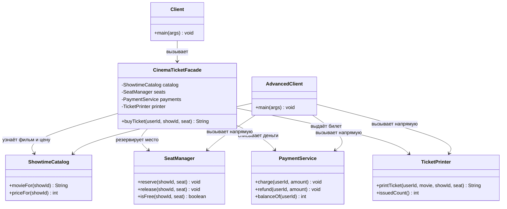
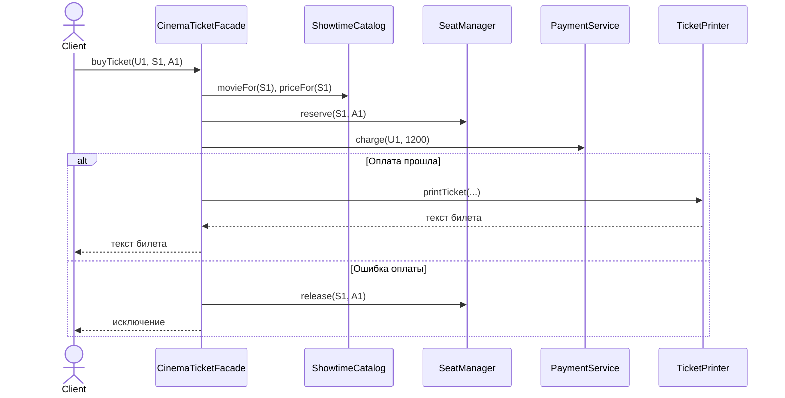

# Разбор проекта покупки билета в кино

Проект показывает паттерн Facade на одном действии: покупке билета. `Client` вызывает один метод фасада, а фасад последовательно работает с каталогом, местами, оплатой и билетами. `AdvancedClient` делает те же вызовы самостоятельно. Номера строк ниже относятся к файлам в папке `src/cinema`.

## UML диаграмма классов

Диаграмма написана в формате Mermaid и отображается в GitHub при открытии этого Markdown-файла.

Стрелка показывает, **кто вызывает кого**. Стрелок от подсистем к `CinemaTicketFacade` нет: каталог, места, оплата и билеты не знают о существовании фасада.

## UML диаграмма последовательности

## Общий синтаксис Java

- `package cinema;` в первой строке каждого файла означает, что все классы принадлежат одному пакету `cinema`. Поэтому файлы лежат в `src/cinema`.
- `import` подключает готовые классы Java. Например, `Map` хранит пары «ключ → значение», а `Set` — набор элементов без повторений.
- `public class Name { ... }` объявляет класс. `public` позволяет использовать его из других пакетов. Фигурные скобки ограничивают тело класса или метода.
- `private` скрывает поле или метод от других классов. `final` означает, что переменную после присваивания нельзя направить на другой объект.
- `void` означает, что метод ничего не возвращает; `return` возвращает значение; `throw` сообщает об ошибке через исключение.
- Пустые строки отделяют части кода и не выполняются.

## Класс ShowtimeCatalog

Файл `ShowtimeCatalog.java`. Это каталог сеансов: он проверяет ID сеанса и выдаёт фильм и цену.

| Строки | Что происходит |
| --- | --- |
| 1 | `package cinema;` относит класс к пакету проекта. |
| 3 | `import java.util.Map;` подключает тип словаря. |
| 5 | Строка `public class ShowtimeCatalog` объявляет класс. |
| 6–7 | `movies` связывает `S1` с `Moon Mission`, а `S2` с `Ocean Life`. Ключ `String` — ID сеанса, значение `String` — название фильма. |
| 8–9 | `prices` связывает эти же ID с ценами 1200 и 900. Значение `Integer` — целое число. |
| 11–14 | `movieFor` сначала вызывает `checkShow`, затем возвращает название фильма. |
| 16–19 | `priceFor` тоже проверяет сеанс и возвращает его цену типа `int`. |
| 21–25 | Приватный `checkShow` проверяет, что ID не `null` и есть в каталоге. Иначе `throw` выдаёт `IllegalArgumentException`. |
| 26 | Закрывается тело класса. |

**Связь:** фасад и продвинутый клиент вызывают каталог **до** резерва места. Неизвестный сеанс сразу прерывает покупку, не меняя состояние остальных подсистем.

## Класс SeatManager

Файл `SeatManager.java`. Он знает, какие места свободны **на каждом отдельном сеансе**.

| Строки | Что происходит |
| --- | --- |
| 1 | Класс входит в пакет `cinema`. |
| 3–6 | Импортируются `Map` и `Set`, а также их изменяемые реализации `HashMap` и `HashSet`. |
| 8 | Объявление класса. |
| 9 | `allSeats` задаёт два допустимых места: `A1` и `A2`. |
| 10 | `freeSeats` — словарь: ID сеанса → набор свободных мест. |
| 12–15 | Конструктор создаёт **отдельный** набор свободных мест для `S1` и `S2`. Продажа `A1` на `S1` не занимает `A1` на `S2`. |
| 17–22 | `reserve` находит набор сеанса и удаляет место. `remove` возвращает `false`, если места нет или оно уже занято; тогда выбрасывается ошибка. |
| 24–29 | `release` возвращает место при отмене покупки. Метод отклоняет неизвестный сеанс, недопустимое место или повторное освобождение. |
| 31–34 | `isFree` возвращает `true`, только если сеанс есть и место находится в наборе свободных. Это удобно для прямого использования подсистемы. |
| 35 | Закрывается класс. |

**Связь:** фасад вызывает `reserve` перед оплатой. Если затем возникает ошибка, он вызывает `release`, чтобы место опять можно было купить.

## Класс PaymentService

Файл `PaymentService.java`. Он отвечает только за баланс и оплату.

| Строки | Что происходит |
| --- | --- |
| 1 | Пакет `cinema`. |
| 3–4 | Импорты словаря и его изменяемой реализации. |
| 6 | Объявление класса. |
| 7–8 | `balances` хранит условный баланс: у `U1` — 3000, у `U2` — 500. `HashMap` выбран потому, что баланс меняется. |
| 10–16 | `charge` получает пользователя и сумму. Строка 11 читает баланс; строки 12–14 отклоняют неположительную сумму, неизвестного пользователя или нехватку денег. Строка 15 вычитает стоимость билета. |
| 18–20 | `refund` прибавляет сумму обратно. Фасад вызывает его только после успешного списания, если следующий шаг покупки завершится ошибкой. |
| 22–24 | `balanceOf` возвращает баланс; для неизвестного пользователя возвращает 0. Метод полезен при прямой проверке подсистемы. |
| 25 | Закрывается класс. |

**Связь:** каталог определяет цену, а фасад передаёт эту цену в `charge`. `PaymentService` ничего не знает ни о местах, ни о билетах, ни о фасаде.

## Класс TicketPrinter

Файл `TicketPrinter.java`. В учебном примере он создаёт **текстовый** билет; физического принтера нет.

| Строки | Что происходит |
| --- | --- |
| 1 | Пакет `cinema`. |
| 3–4 | Подключаются `List` и изменяемый `ArrayList`. |
| 6 | Объявление класса. |
| 7 | `issuedTickets` хранит уже выданные текстовые билеты. |
| 9–14 | `printTicket` создаёт строку билета. Строки 10–11 собирают номер, фильм, сеанс, место и пользователя. Номер равен количеству ранее выданных билетов плюс один. Строка 12 сохраняет билет, строка 13 возвращает его вызывающему коду. |
| 16–18 | `issuedCount` возвращает число выданных билетов. |
| 19 | Закрывается класс. |

**Связь:** фасад вызывает принтер **после** успешного резерва и оплаты. Билет `T1` — первый билет конкретного объекта `TicketPrinter`.

## Класс CinemaTicketFacade

Файл `CinemaTicketFacade.java`. Это главный класс паттерна. Он предлагает один простой метод, скрывая порядок работы четырёх подсистем.

| Строки | Что происходит |
| --- | --- |
| 1 | Пакет `cinema`. |
| 3 | Объявление класса фасада. |
| 4–7 | Фасад создаёт каталог, менеджер мест, оплату и принтер. Поля `private`: обычный клиент не управляет ими напрямую. |
| 9 | Начинается публичный метод `buyTicket`. Параметры: пользователь, сеанс, место. Результат `String` — готовый билет. |
| 10–11 | Каталог проверяет сеанс и возвращает название фильма и цену. Ошибка здесь происходит ещё до изменения места или баланса. |
| 12 | Менеджер мест резервирует выбранное место. Если оно занято, выполнение прекращается до оплаты. |
| 14 | Флаг `paid` запоминает, списаны ли деньги. Сначала это `false`. |
| 15–18 | Блок `try`: оплата, смена флага на `true`, создание и возврат билета. |
| 19 | `catch` срабатывает, если оплата или выдача билета выбросила ошибку. |
| 20–22 | Если деньги уже списаны, фасад возвращает их. Если оплату отклонили, возврат денег не нужен. |
| 23 | Зарезервированное место снова становится свободным. |
| 24 | `throw error` передаёт исходную ошибку клиенту; фасад не скрывает неудачу. |
| 25–27 | Закрываются блок обработки ошибки, метод и класс. |

**Почему это фасад:** клиент видит только `buyTicket`. Логика проверки, резерва, оплаты и создания билета остаётся в отдельных подсистемах. Фасад знает их правильный порядок и выполняет компенсацию при ошибке.

## Класс Client

Файл `Client.java`. Это **обычный клиент**, который соблюдает требование задания: работает только с фасадом.

| Строки | Что происходит |
| --- | --- |
| 1 | Пакет `cinema`. |
| 3 | Объявление класса. |
| 4 | `main` — точка входа при запуске `java -cp out cinema.Client`. |
| 5 | Создаётся один объект `CinemaTicketFacade`. Подсистемы клиент не создаёт. |
| 6 | Один вызов `buyTicket` покупает место `A1` на сеанс `S1` для `U1`. Возвращённый текст хранится в `ticket`. |
| 7 | `System.out.println` печатает билет в консоль. |
| 8–9 | Закрываются метод и класс. |

Код клиента короткий именно потому, что порядок работы подсистем спрятан за фасадом.

## Класс AdvancedClient

Файл `AdvancedClient.java`. Это **отдельный пример** для требования задания: подсистемы остаются доступными напрямую опытному клиенту. Он показывает, сколько шагов обычному клиенту пришлось бы делать без фасада.

| Строки | Что происходит |
| --- | --- |
| 1 | Пакет `cinema`. |
| 3–4 | Объявление класса и точка входа `main`. |
| 5–8 | Клиент сам создаёт все четыре подсистемы. Фасад здесь не создаётся. |
| 10–12 | Задаются сеанс `S2`, место `A2` и пользователь `U1`. |
| 13–14 | Клиент сам узнаёт фильм и цену из каталога. |
| 15 | Клиент сам резервирует место. |
| 16 | Флаг `paid` показывает, прошла ли оплата. |
| 17–20 | В `try` клиент списывает деньги, отмечает успешную оплату и печатает билет. |
| 21–27 | В `catch` клиент сам возвращает деньги, если они были списаны, освобождает место и передаёт ошибку дальше. |
| 28–29 | Закрываются метод и класс. |

`AdvancedClient` больше и сложнее `Client`, потому что напрямую координирует четыре подсистемы. Это не ошибка: по определению Facade подсистемы **могут** использоваться и без фасада.

## Что сказать на защите

«У меня четыре независимые подсистемы: каталог, места, оплата и выдача билета. `CinemaTicketFacade` даёт обычному клиенту один метод `buyTicket` и вызывает подсистемы в нужном порядке. При ошибке оплаты место освобождается. `Client` использует только фасад, а `AdvancedClient` показывает, что подсистемы доступны и напрямую. Ни один класс подсистемы не ссылается на фасад».
