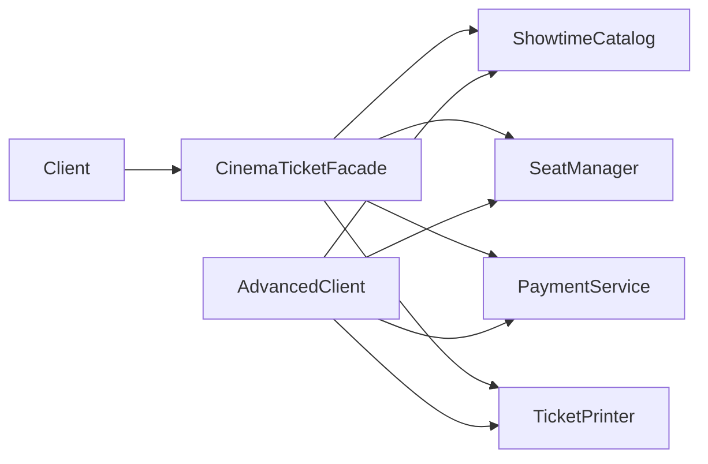

# Как понять Facade на примере покупки билета в кино

## Объяснение как для десятилетнего

Представь кассу кинотеатра. Ты говоришь кассиру: «Хочу билет на сеанс S1, место A1». Кассир сам смотрит расписание, проверяет место, берёт оплату и выдаёт билет. Тебе не нужно бегать к четырём разным сотрудникам. В программе этот «кассир» — `CinemaTicketFacade`.

## Восемь карточек

| № | Идея | На нашем примере |
| --- | --- | --- |
| 1 | Есть сложная задача | Для покупки нужно выполнить несколько шагов в правильном порядке. |
| 2 | Подсистема состоит из частей | Каталог, места, оплата и билет — четыре отдельных класса. |
| 3 | Фасад даёт простой вход | `buyTicket(userId, showId, seat)` запускает всю покупку. |
| 4 | Порядок важен | Сначала узнаём сеанс, затем резервируем место, платим и получаем билет. |
| 5 | Ошибки надо исправлять | Если оплата не прошла, место освобождается. |
| 6 | Обычный клиент прост | `Client` знает только `CinemaTicketFacade`. |
| 7 | Подсистемы не спрятаны навсегда | `AdvancedClient` может работать с ними напрямую. |
| 8 | Задачи разделены | Каждый класс отвечает за свой участок, фасад только координирует. |

## Двадцать процентов темы для восьмидесяти процентов понимания

Запомни три вещи. **Фасад — единая удобная точка входа.** **Он вызывает существующие подсистемы в правильном порядке.** **Подсистемы остаются самостоятельными и не знают о фасаде.** Если ты можешь объяснить эти три предложения на примере `buyTicket`, ты уже понимаешь основу паттерна.

## Карта связей

Обычный клиент идёт через фасад. Продвинутый клиент идёт к подсистемам напрямую. Обратных стрелок от подсистем к фасаду нет.

## Короткая история

Алия хочет место A1 на сеанс S1. Она обращается к кассиру-фасаду. Кассир узнаёт цену фильма, придерживает A1, списывает деньги и выдаёт билет T1. Если денег не хватило, кассир отпускает A1, чтобы место мог купить другой человек. Алия видит один простой результат, хотя внутри произошли четыре действия.

## Ошибки новичков

1. **Называть фасадом класс, который всё делает сам.** В нашем проекте проверка мест живёт в `SeatManager`, а оплата — в `PaymentService`.
2. **Давать обычному клиенту вызовы подсистем.** Тогда ему снова придётся помнить порядок. `Client` вызывает только `buyTicket`.
3. **Считать, что подсистемы обязаны быть закрыты.** `AdvancedClient` доказывает, что их можно использовать напрямую.
4. **Забывать про неудачу в середине процесса.** Если оплата отклонена, место надо освободить.
5. **Путать фасад с интерфейсом Java.** Фасад — роль класса в архитектуре; ключевое слово `interface` для этого не требуется.

## Три ментальные модели

1. **Кассир:** клиент формулирует результат, кассир организует работу отделов.
2. **Пульт с одной кнопкой:** одна команда запускает несколько устройств в нужной последовательности.
3. **Маршрутный лист:** фасад знает порядок остановок и что отменить, если путь оборвался.

## Первый вопрос для проверки понимания

Если оплату отклонили **после** резерва A1, что фасад должен сделать с местом и почему? Следующий вопрос зависит от твоего ответа.
